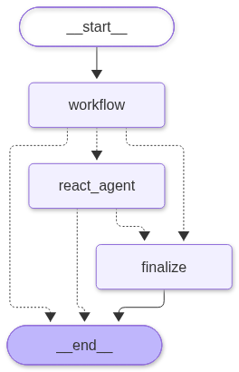

# MultiagentAI-docs

Sistema multi-agente (LangGraph) que genera un **informe de servicio en Word** a partir de `data/config.yaml` y la plantilla `template/template.docx`.

- **image_agent**: busca en la web el logo de la empresa cliente (gratis, sin API keys de búsqueda).
- **writer_agent**: redacta la descripción del servicio a partir de las notas del ingeniero y se auto-revisa.
- **photos**: toma las fotos locales del evento.
- **render_doc**: llena la plantilla y guarda el `.docx` en `output/`.

Las tres primeras ramas se ejecutan en paralelo.

## Instalación

```bash
python3 -m venv venv
venv/bin/pip install -r requirements.txt
```

Crear `.env` en la raíz:

```env
OPENAI_API_KEY=sk-...
OPENAI_MODEL= "selected by you"
```

## Configuración (`data/config.yaml`)

```yaml
client: "Ghost Producciones"
engineer: "Carlos Coronel"
sales_team: "Bruno Chamorro"
table:
  place: "Hotel Westin"
  date: "14/11/2026"
images:
  pictures_event: { origin: local, root: "fotos", ancho_cm: 15 }   # carpeta con fotos
  picture_logo:    { origin: web,   url: "*",     ancho_cm: 10 }   # "*" = buscar con el agente
description: "notas del ingeniero sobre el evento"
```

| Campo | Uso |
|---|---|
| `picture_logo.url` | `"*"` busca el logo con el agente; una URL lo descarga directo; `origin: local` + `root` usa un archivo. |
| `pictures_event.root` | Carpeta de fotos (relativa al proyecto o a `data/`). |
| `description` | Notas para el writer. Si está vacío (o `"text"`), el informe indica que el servicio fue satisfactorio. |

La plantilla usa: `client`, `engineer`, `sales_team`, `table.place`, `table.date`, `picture_logo`, `pictures_event`, `description` y, opcionalmente, una tabla `` con `r.descripcion` / `r.estado`.

## Uso

```bash
venv/bin/python orchestrator.py                                  # usa data/config.yaml
venv/bin/python orchestrator.py --notes "Se instalaron 4 pantallas LED..."
venv/bin/python -m agent.image_agent "Nombre Empresa"            # probar solo el logo
venv/bin/python -m agent.writer_agent.writer_agent "notas..."    # probar solo el texto
```

Salida: `output/Informe_<cliente>_<fecha>.docx`. El logo queda en `data/image/logo_<cliente>.png`.

## Estructura

```
orchestrator.py          grafo principal
core/                    config, logo, fotos y render del Word
agent/image_agent/
  tools/                 búsquedas gratuitas (DuckDuckGo, web oficial, Wikidata, favicon)
  workflow/              paso 1: estrategias fijas (rápido y barato)
  react_agent/           paso 2: agente ReAct (LLM + ToolNode) si el paso 1 falla
  verifier.py            el LLM con visión elige el logo correcto
  image_web_agent.py     une workflow -> react_agent -> respaldo
agent/writer_agent/
  prompt/                prompts
  nodes.py, graph.py     redactar -> revisar -> corregir
```

## Variables de entorno opcionales

| Variable | Default | Descripción |
|---|---|---|
| `LOGO_VERIFY_WITH_LLM` | `1` | `0` desactiva el LLM en el image_agent (solo heurística). |
| `LOGO_REACT_MAX_STEPS` | `12` | Pasos máximos del agente ReAct. |
| `LOGO_DOMAIN_TLDS` | `.pe,.com.pe,.com,...` | Dominios a probar si el buscador falla. |

## Grafos

### Orquestador


### Image agent

| Principal | Workflow (paso 1) | ReAct (paso 2) |
|---|---|---|
|  |  |  |

### Writer agent


Para regenerar las imágenes:

```python
from orchestrator import build_graph
open("img/orchestrator.png", "wb").write(build_graph().get_graph().draw_mermaid_png())
```
