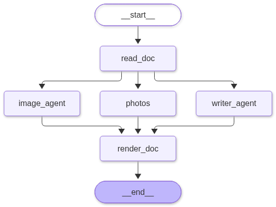
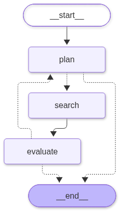
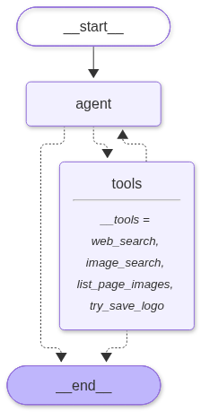
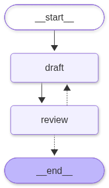

# MultiagentAI-docs

Multi-agent system (LangGraph) that generates a **service report in Word** from `data/config.yaml` and the template `template/template.docx`.

- **image_agent**: searches the web for the client company's logo (free, no search API keys).
- **writer_agent**: writes the service description from the engineer's notes and reviews itself.
- **photos**: collects the local event photos.
- **render_doc**: fills the template and saves the `.docx` to `output/`.

The first three branches run in parallel.

## Installation

```bash
python3 -m venv venv
venv/bin/pip install -r requirements.txt
```

Create a `.env` file in the project root:

```env
OPENAI_API_KEY=sk-...
OPENAI_MODEL= "selected by you"
```

## Configuration (`data/config.yaml`)

```yaml
client: "Ghost Producciones"
engineer: "Carlos Coronel"
sales_team: "Bruno Chamorro"
table:
  place: "Hotel Westin"
  date: "14/11/2026"
images:
  pictures_event: { origin: local, root: "fotos", ancho_cm: 15 }   # folder with photos
  picture_logo:    { origin: web,   url: "*",     ancho_cm: 10 }   # "*" = search with the agent
description: "engineer's notes about the event"
```

| Field | Usage |
|---|---|
| `picture_logo.url` | `"*"` searches for the logo with the agent; a URL downloads it directly; `origin: local` + `root` uses a local file. |
| `pictures_event.root` | Photos folder (relative to the project root or to `data/`). |
| `description` | Notes for the writer. If empty (or `"text"`), the report states that the service was completed satisfactorily. |

The template uses: `client`, `engineer`, `sales_team`, `table.place`, `table.date`, `picture_logo`, `pictures_event`, `description` and, optionally, a table `` with `r.descripcion` / `r.estado`.

## Usage

```bash
venv/bin/python orchestrator.py                                  # uses data/config.yaml
venv/bin/python orchestrator.py --notes "4 LED screens were installed..."
venv/bin/python -m agent.image_agent "Company Name"               # test only the logo search
venv/bin/python -m agent.writer_agent.writer_agent "notes..."    # test only the writer
```

Output: `output/Informe_<client>_<date>.docx`. The logo is saved to `data/image/logo_<client>.png`.

## Structure

```
orchestrator.py          main graph
core/                    config, logo, photos and Word rendering
agent/image_agent/
  tools/                 free searches (DuckDuckGo, official website, Wikidata, favicon)
  workflow/              step 1: fixed strategies (fast and cheap)
  react_agent/           step 2: ReAct agent (LLM + ToolNode) if step 1 fails
  verifier.py            vision LLM picks the correct logo
  image_web_agent.py     joins workflow -> react_agent -> fallback
agent/writer_agent/
  prompt/                prompts
  nodes.py, graph.py     draft -> review -> revise
```

## Optional environment variables

| Variable | Default | Description |
|---|---|---|
| `LOGO_VERIFY_WITH_LLM` | `1` | `0` disables the LLM in the image_agent (heuristics only). |
| `LOGO_REACT_MAX_STEPS` | `12` | Maximum steps of the ReAct agent. |
| `LOGO_DOMAIN_TLDS` | `.pe,.com.pe,.com,...` | Domains to try if the search engine fails. |

## Graphs

### Orchestrator



### Image agent

| Main | Workflow (step 1) | ReAct (step 2) |
|---|---|---|
|  |  |  |

### Writer agent



To regenerate the images:

```python
from orchestrator import build_graph
open("img/orchestrator.png", "wb").write(build_graph().get_graph().draw_mermaid_png())
```
